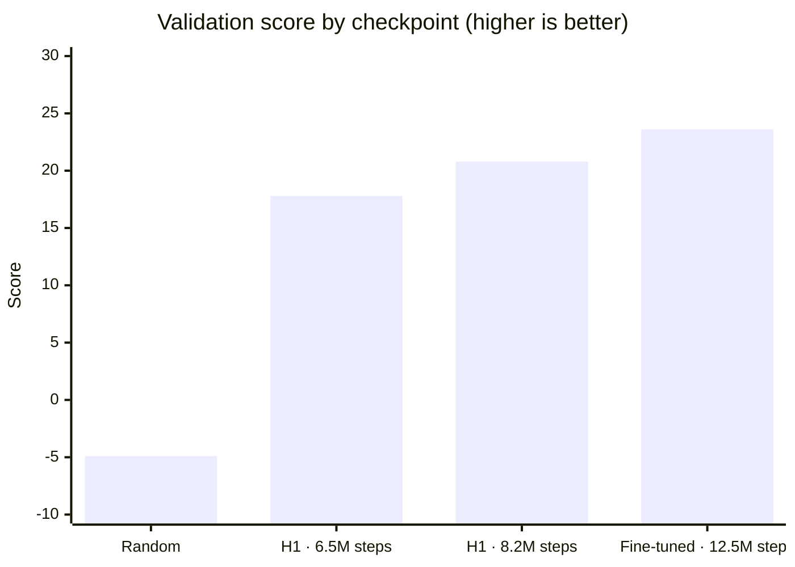
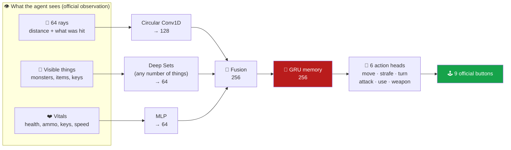
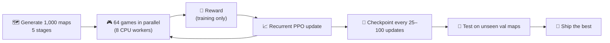

<div align="center">

# 🔥 DOOMSDAY

### A neural network that learned to play DOOM by playing DOOM.

**Yugaantar 2026 · DevForge Track 1: "Can It Play DOOM?"**


*No scripts. No pathfinding. No aimbot. No map knowledge.*
*Every button press comes from a small network that taught itself, one decision at a time.*

</div>

---

## ⚡ At a glance

| | |
|---|---|
| 🧠 **What it is** | A 625k-parameter recurrent policy (GRU memory) trained from scratch with our own PPO implementation |
| 🎮 **What it sees** | Only the official observations: 64 depth rays around the player, visible things, health/ammo/keys |
| 🕹️ **What it does** | Presses the 9 official buttons: move, strafe, turn, attack, use, switch weapon |
| 🏋️ **How it learned** | ~12.5 million decisions of trial and error on 1,000 procedurally generated maps, on a laptop CPU |
| 🚀 **How fast it runs** | 0.7 ms per decision (p99) on 1 CPU thread, well inside the 40 ms budget |
| ✅ **Rules** | Pure RL. No hand rules, no A\*/Dijkstra, no `atan2` aiming, no `privileged_state()` at play time |

---

## 🏆 Results on maps it has never seen

Measured on our **held-out validation maps** (never used for training) over **8 seeds**,
with the official wrapper, 1 CPU thread and sampled actions.

| Map type | What it tests | Exits reached |
|---|---|:---:|
| 🚶 **Locomotion** | Get around corridors and rooms to the exit | **32 / 32 · 100%** |
| 🔑 **Keys** | Find a keycard, open the locked door, exit | **32 / 32 · 100%** |
| 🚪 **Doors** | Open doors (without slamming them shut again) | **16 / 32 · 50%** |
| 💥 **Combat** | Reach the exit through monsters | **10 / 32 · 31%** |
| ☠️ **Full gauntlet** | Everything at once | 2 / 32 · 6% |
| 🗺️ **Real Freedoom levels** | Full-size human-made levels, never trained on | 2 / 136 |

**Overall score: 23.6** on our scoring yardstick, versus **−4.9** for random button presses.
That yardstick mirrors the organisers' categories (exit, health, time, keys, doors, kills, exploration).
It is our own copy, not the official formula.

### How it got better



Fine-tuning from 6.5M to 12.5M steps raised keys from **6/12 to 12/12** completed and cut door
"reversals" (pressing USE on a moving door, which sends it back) from **137 to 48**.

---

## 🧠 How it works



- **Rays are circular.** The 64 rays wrap 360° around the player, so the convolution wraps too: a wall behind you is next to a wall on your left.
- **Monsters come and go.** The entity encoder is order-free and works with zero or many visible things.
- **Memory.** The GRU remembers where it has been and what it has seen, reset at the start of every map.
- **Nothing absolute.** Every input is relative to the player. No map name, id or coordinates reach the network.

---

## 🏋️ How it learned



**1. A curriculum of procedurally generated maps.** Our own generator builds vanilla-format maps in
five stages: *locomotion → doors → keys → combat → full gauntlet*. Validation maps come from a
separate generator family and are never trained on.

**2. Rewards that explain the goal, not the solution.** These are used only during training:

| Reward | Weight | Why |
|---|---:|---|
| 🏁 Reach the exit | +10 | The main goal |
| 🔑 Pick up a key | +3 | Keys unlock progress |
| 🔓 Open a locked door | +3 | Using the key |
| 🚪 Open a door | +1 | Getting through |
| 👾 Kill a monster | +0.5 | Clearing the way (capped at the map's monster count, so it can't be farmed) |
| 🗺️ Visit a new area | +0.05 | Curiosity |
| 🩸 Take damage | −0.01 per HP | Stay healthy |
| ☠️ Die | −3 | Stay alive |
| 🔁 Reverse a moving door | −0.3 | Learns the engine quirk instead of a hard-coded rule |

Every event pays **once per episode**, so the agent can't farm a door by opening it again and again.

**3. Our own recurrent PPO.** Written from scratch in PyTorch: GRU sequences of 128 steps,
factored action heads, value normalisation, and safety checks that stop the run if the
importance ratio or gradients misbehave.

**4. Select on unseen maps, not on training reward.** Every candidate is scored on held-out maps
with several map seeds *and* several agent seeds. A new model replaces the old one only if it wins
by more than the seed-to-seed noise.

**Compute:** one Apple M4 laptop, CPU only, about 1,500 decisions per second, about 3 hours of training in all.

---

## 🚀 Quick start

```bash
uv sync                      # Python 3.13, installs ViZDoom and the official wrapper
uv run python validate.py    # loads our agent and plays the test map
```

Expected: `PASSED`, exit reached on `two_rooms` in 55 steps.

**Train it yourself:**

```bash
uv run python -m training.train --config training/configs/h1.json
```

**Evaluate a checkpoint on the held-out maps:**

```bash
uv run python -m training.eval.harness --split val --seeds 0 1 2 --repo . --run-id my-eval
```

---

## 📁 What's where

```
submission/
  agent.py            ← DoomAgent: the evaluated entry point (CPU, 1 thread)
  doom_agent/         ← observation processing + policy network (inference only)
  weights/            ← policy.pt (Git LFS) + policy.json (provenance and config)
training/
  train.py            ← training entry point
  ppo/                ← our recurrent PPO
  envs/               ← vectorised environments, curriculum, map registry
  rewards/            ← reward terms (training only)
  eval/               ← held-out evaluation harness and metrics
  configs/            ← run configs
docs/                 ← contract, design docs and DECISIONS.md (every major decision, with evidence)
env/, validate.py     ← official template files, unchanged
```

---

## 🛡️ Playing fair

| ❌ Not in this repo | ✅ Instead |
|---|---|
| Hand-written gameplay rules or decision trees | One forward pass of a trained network picks every action |
| A\*, Dijkstra or any pathfinding | The GRU memory learns to explore |
| `atan2` / trigonometric aiming | Aiming is learned from rays and visible things |
| `privileged_state()` at play time | Used only to compute training rewards; never imported by `submission/` |
| Map-specific tricks | Trained on generated maps only; tested on unseen ones |
| Behaviour cloning from scripts | Learned purely from its own experience |

`submission/` never imports `training/`, and a test checks it.

---

## 🔍 Honest limitations

- **Combat is the weak spot.** The agent learned that fighting often costs more than it gains, so it
  mostly avoids it. On full gauntlet maps it usually dies before the exit.
- **Real levels are hard.** Freedoom levels are much bigger than our generated maps; it finishes 2 of 136.
- **One laptop, one night.** About 12.5M decisions of experience. More training, a combat curriculum
  and a learned spatial map are the clear next steps (designs in `docs/SPATIAL_OBSERVATION_DESIGN.md`).

---

## 📚 Read more

| Doc | Inside |
|---|---|
| [docs/DECISIONS.md](docs/DECISIONS.md) | Every major decision with the measurements behind it |
| [docs/MODEL.md](docs/MODEL.md) | Network architecture, parameter count, benchmarks |
| [docs/TRAINING.md](docs/TRAINING.md) | The PPO engine and training setup |
| [docs/EVALUATION_PROTOCOL.md](docs/EVALUATION_PROTOCOL.md) | How we measure generalisation |
| [docs/CONTRACT.md](docs/CONTRACT.md) · [docs/RULES.md](docs/RULES.md) | The official contract and rules |

<div align="center">

*Built for Yugaantar 2026 · DevForge, Track 1.*

</div>
